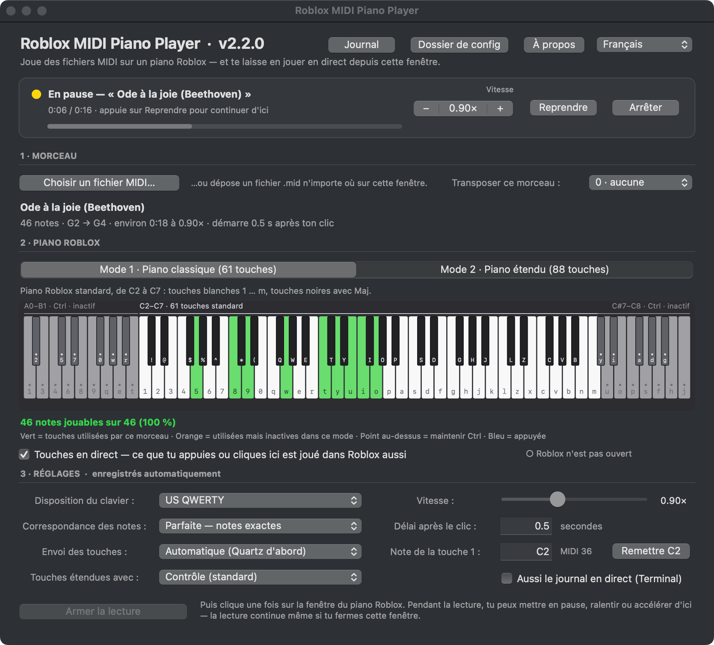

# Roblox MIDI Piano Player

Play any MIDI file on a Roblox piano. Pick a song, see on a picture of the piano which keys it uses, click **Arm playback**, then click the Roblox piano once: the app presses the right keys at the right time, chords and all. While it plays you can slow it down, speed it up or pause it, and you can play the Roblox piano yourself from the app's window, with your keyboard or your mouse.

It is a small native macOS app, in English and French, with nothing to install besides itself. Everything runs on your Mac: nothing is uploaded anywhere.


## What it does

- **Plays MIDI files on the Roblox piano.** Each note becomes the key the Roblox piano expects: white keys `1` … `m`, black keys with Shift. Notes are held for their real length, chords land together, tempo changes are followed, and drum tracks are left out.
- **Both Roblox pianos.** *Mode 1* is the classic 61-key piano (C2–C7). *Mode 2* is the full 88-key piano (A0–C8) of games such as *Talent Show*, whose lowest and highest notes are the dotted keys played with Ctrl. The picture of the piano shows which keys a song uses, and the app tells you how many notes the other mode would add or lose.
- **Live speed and pause.** While a song plays, **−** and **+** change the speed on the spot, from 0.25× to 2×, and **Pause** holds the song exactly where it is. The music never jumps or rushes to catch up.
- **Live keys.** While the app's window is in front, the piano keys you press on your keyboard are pressed in Roblox too, and so are the keys you click on the piano picture. Pressed keys turn blue, and no key can stay stuck down.
- **Keeps playing in the background.** Keys go straight to the Roblox process, so you can switch to other apps while a song plays.
- **Exact or best fit.** *Perfect* mapping plays every note exactly where it is written and skips what is outside the piano; *Smart best fit* may shift a song to fit more of it. Any song can also be transposed by semitones.
- **Ready to try.** Three demo songs are built in: *Ode to Joy*, *Für Elise* and arpeggios across all 88 keys.
- **US QWERTY and French AZERTY** keyboards, an optional free-form layout for unusual pianos, and the whole window in English or French.
- **Light.** The whole app is about 500 KB, and while it waits it uses almost no processor time (0.5 % of one core).
- **Uninstalls itself, completely.** **Uninstall Roblox MIDI Piano Player…** in the app menu finds this app and every older copy of any version, downloaded archives, settings, logs and its permission, shows you the list, and moves it all to the Trash, so nothing is left behind.

| The status card, paused | Mode 2 with the full-range demo |
| --- | --- |
|  |  |

## Quick start

1. Download `Roblox-MIDI-Piano-Player-2.2.0.zip` from the [latest release](https://github.com/GodisGood-GodisGreat-and-GodisReal-Amen/Roblox-MIDI-Piano-Player/releases/latest), unzip it, and move the app to **Applications**.
2. Open it. The app is not signed by Apple, so the first time click **Open Anyway** in **System Settings › Privacy & Security**. Then click **Allow…** in the app and switch it on under **Accessibility**, so it can send keys.
3. Open Roblox at a piano. In the app, choose a song (or **File › Demo Songs**), pick Mode 1 or Mode 2, click **Arm playback**, and click the Roblox window once.

Or build it from source, which needs nothing but a Mac:

```bash
git clone https://github.com/GodisGood-GodisGreat-and-GodisReal-Amen/Roblox-MIDI-Piano-Player.git
cd Roblox-MIDI-Piano-Player
./build.sh --install
```

The [startup guide](docs/getting-started.md) goes through each step, including the two macOS permissions.

## Documentation

- [Getting started](docs/getting-started.md): requirements, installing, the macOS permissions, your first song, playing live, where things go, updating, uninstalling.
- [User manual](docs/manual.md): every control, setting, menu and shortcut, and the key maps of both pianos.
- [Building it yourself](docs/building.md): the build script and its compact copy of the script, the four tests, the demo songs, the icon and making a release.
- [How it works](docs/architecture.md): the window and the background player, the MIDI parser, the timing engine, live speed and live keys, the files they share, the uninstaller, and what it all costs.
- [Troubleshooting](docs/troubleshooting.md): what to do when something does not work.
- [Contributing](CONTRIBUTING.md) and the [changelog](CHANGELOG.md).

## How it works, in one paragraph

The whole app is one JavaScript for Automation script, [`src/main.js`](src/main.js), in an ordinary app bundle whose launcher starts it with `osascript` (the bundle carries a compact copy, without the comments); the window is built with AppKit straight from JavaScript. Loading a song parses the MIDI file (every track, tempo changes, note lengths) and maps each note onto the chosen piano. Arming starts a separate background player that waits for Roblox to come to the front, then sends each chord's keys to the Roblox process with `CGEventPostToPid`. Only the key presses are on the time-critical path: key releases are budgeted into the gaps, and when a big chord runs late the rest of the song shifts by the overrun instead of rushing, so the pulse stays steady. The window and the player talk through small JSON files in `~/Library/Application Support/Roblox MIDI Piano Player/`: the player reports its state and position, and the window writes the speed and the pause, which the player picks up within a tenth of a second and applies from the note that is playing. Live keys use the same sender from the window itself, and keep track of every key they press so that nothing is ever left down in Roblox.

## Macs and pianos

The app runs on macOS 10.15 Catalina or newer. It was made on a Mac with Apple silicon, and its playback engine was tuned by ear against the real Roblox piano; Intel Macs run the same script but have not been tested. It plays the standard Roblox piano layout (61 keys, `1` … `m` with Shift for the black keys), used by most piano games, and its 88-key extension with Ctrl. Games that map their piano to other keys can use a custom layout.

## Privacy and network use

The app works entirely on your Mac and never connects to the internet. It sends key presses to the Roblox process and nowhere else, and it reads nothing from Roblox. The only web pages it opens are this project's, and only when you ask: from **About** or the **Help** menu. Settings and logs stay in `~/Library/Application Support/Roblox MIDI Piano Player/`.

## En français

L'app est entièrement traduite : choisis **Français** en haut à droite de la fenêtre. Elle joue n'importe quel fichier MIDI sur un piano Roblox (61 ou 88 touches) ; pendant la lecture, **−** et **+** changent la vitesse en direct et **Pause** arrête le morceau là où il en est. Avec les **touches en direct**, ce que tu appuies sur ton clavier ou que tu cliques sur l'image du piano est aussi joué dans Roblox. Pour l'installer, suis le [démarrage rapide](#quick-start) ci-dessus.



## License

Public domain. Roblox MIDI Piano Player is released under [The Unlicense](LICENSE): copy it, change it, share it, build on it, no credit needed.

Roblox is a trademark of Roblox Corporation. This project is not affiliated with or endorsed by Roblox.
