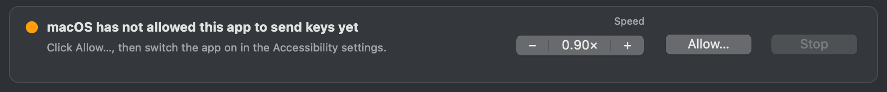

# Getting started

This guide takes you from nothing to your first song played on a Roblox piano, and then to playing the piano yourself from the app.

## 1. Requirements

| What | Why | Check |
| --- | --- | --- |
| **A Mac with macOS 10.15 Catalina or newer** | the app is a native macOS app; Apple silicon and Intel Macs both work | Apple menu › About This Mac |
| **Roblox, and a game with a piano** | the app plays the piano that is in front of your character | open the game and sit at the piano |
| **The Accessibility permission** for the app | the app sends key presses to Roblox, which macOS only allows to apps you trust | System Settings › Privacy & Security › Accessibility |
| **A MIDI file** (`.mid`) | the song to play; the app comes with three demo songs | **File › Demo Songs** |

Nothing else needs installing. To build the app from its source instead of downloading it, you only need `git` (which macOS offers to install the first time you type it in Terminal); see [section 2](#build-it-yourself).

## 2. Install the app

### Download

1. Download `Roblox-MIDI-Piano-Player-2.1.1.zip` from the [latest release](https://github.com/GodisGood-GodisGreat-and-GodisReal-Amen/Roblox-MIDI-Piano-Player/releases/latest).
2. Double-click it to unzip it, and move **Roblox MIDI Piano Player** into your **Applications** folder.

### Build it yourself

```bash
git clone https://github.com/GodisGood-GodisGreat-and-GodisReal-Amen/Roblox-MIDI-Piano-Player.git
cd Roblox-MIDI-Piano-Player
./build.sh --install
```

This takes a few seconds: nothing is compiled. The app lands in `/Applications`. A copy you build yourself skips the next step, because macOS only checks apps downloaded from the internet. [Building it yourself](building.md) covers the build script and the tests.

## 3. First start

### "Apple could not verify…"

The app is free and not signed by Apple, so the first time you open a downloaded copy, macOS stops it and says it cannot verify the developer. To open it anyway:

1. Open the app once and close the message (choose **Done**, not **Move to Trash**).
2. Open **System Settings › Privacy & Security**, scroll down to the message about **Roblox MIDI Piano Player** and click **Open Anyway**, then confirm with your password.

From then on it opens normally. If you prefer Terminal, this does the same:

```bash
xattr -dr com.apple.quarantine "/Applications/Roblox MIDI Piano Player.app"
```

### Allow it to send keys

The app sends key presses to Roblox, so macOS must allow it to control your computer. Until it does, the window says *macOS has not allowed this app to send keys yet* and shows an **Allow…** button:



1. Click **Allow…**. macOS adds the app to the list and opens **System Settings › Privacy & Security › Accessibility**.
2. Switch on **Roblox MIDI Piano Player**. If macOS lists **osascript** instead (the program that runs the app's script), switch that on.
The window notices within a couple of seconds and the status reads **Ready.**; if it does not, quit the app and open it again. The live keys line under the piano picture then says whether Roblox is open.

## 4. Your first song

1. **Open Roblox**, join a game with a piano, and sit at the piano so that pressing `1` on your keyboard plays a note.
2. **In the app, choose a song.** Click **Choose MIDI file…**, use **File › Open MIDI…** (⌘O), or drop a `.mid` file anywhere on the window. To try it right away, choose **File › Demo Songs › Ode to Joy (Beethoven)**.
3. **Pick the piano.** Most Roblox pianos are **Mode 1 · Classic piano (61 keys)**. If yours has dotted keys for the very low and very high notes (as in *Talent Show*), choose **Mode 2 · Extended piano (88 keys)**. The picture shows which keys the song uses, in green.
4. **Click Arm playback.** The status says *Armed — click the Roblox piano window once*.
5. **Click the Roblox window once.** Half a second later, the song starts.

While it plays, the status card shows the position, the length and the speed. Click **−** or **+** to slow it down or speed it up, **Pause** to hold it, and **Stop** to end it. You can switch to other apps: the song keeps playing in Roblox.


## 5. Playing live

With the app's window in front, press the piano keys on your keyboard (`1` … `m`, with Shift for the black keys): they are pressed in Roblox too, and turn blue on the picture. You can also click the keys on the picture, or drag across them for a glissando. The line under the picture says **Connected to Roblox** when Roblox is open.

The [user manual](manual.md#8-live-keys) explains which keys are passed on and which are not.

## 6. Where things go

Everything the app keeps is in `~/Library/Application Support/Roblox MIDI Piano Player/`. **Config folder** in the window opens it.

| File | Contents |
| --- | --- |
| `config.json` | your settings, saved as you change them, and where the window was |
| `playback.log` | what the last song did, step by step; **Open log** opens it |
| `playback_state.json` | what the background player is doing now: waiting, playing, its position and speed |
| `playback_control.json` | the speed and pause the window asks for while a song plays |
| `playback.pid`, `playback.stop` | the background player's process number, and its stop signal |
| `playback_job_….json` | the song being played, mapped to keys; removed when it ends |
| `launch_playback_worker.sh`, `open_live_log.command` | small scripts the app writes to start the player and the live log |
| `ui_window.json` | where the window is, for test scripts |

The app keeps nothing anywhere else.

## 7. Updating

Download the new release and replace the app in **Applications**. If you built it yourself:

```bash
git pull
./build.sh --install
```

`--install` updates the files inside the installed app instead of replacing it, so macOS keeps the Accessibility permission. Your settings stay in the config folder either way.

## 8. Uninstalling

Quit the app, move it to the Trash, and delete its folder in `~/Library/Application Support/` if you want your settings gone too. Remove it from **System Settings › Privacy & Security › Accessibility** with the **−** button.

## 9. Command-line options and environment variables

The launcher passes its arguments on to the app, so these work with the app's executable, `/Applications/Roblox MIDI Piano Player.app/Contents/MacOS/RobloxMidiPianoPlayer`:

| Option | What it does |
| --- | --- |
| `--midi FILE` | opens the window with this song loaded |
| `--dialogs` | the older, dialog-based way of choosing and playing a song |
| `--selftest-senders [background]` | plays a short phrase into a running Roblox piano with Quartz, then with Accessibility, and logs how fast each was; `background` puts Roblox behind another app first |
| `--ui-selftest MIDI PREFIX [arm]` | builds the window, goes through its features and saves a picture after each step (see [Building it yourself](building.md#4-testing)) |

| Variable | Default | Meaning |
| --- | --- | --- |
| `ROBLOX_MIDI_PLAYER_SUPPORT_DIR` | the folder above | keeps settings, logs and state in another folder (the tests use it so your own settings are never touched) |
| `ROBLOX_MIDI_PLAYER_ALLOW_QUARTZ` | unset | `1` forces Quartz key sending whatever the setting says (kept for older setups) |

## Next

The [user manual](manual.md) covers every control. [Troubleshooting](troubleshooting.md) helps when something does not work. [How it works](architecture.md) explains the code if you want to change something.
