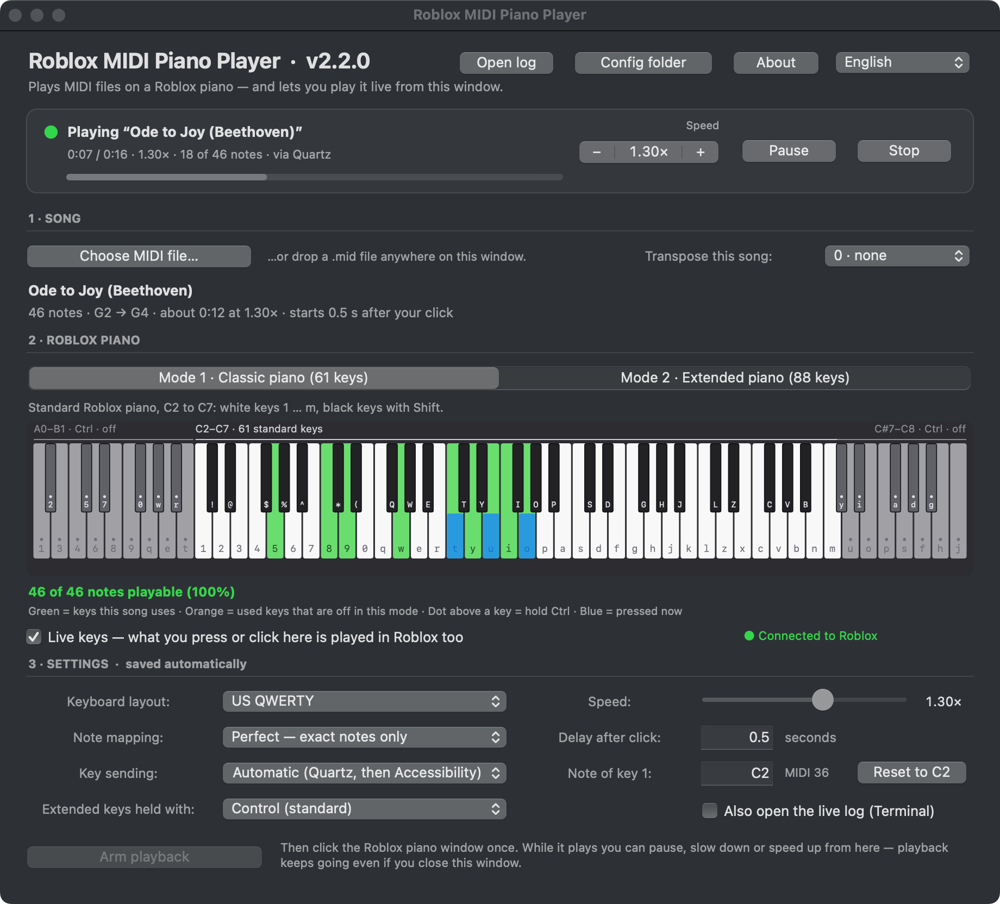
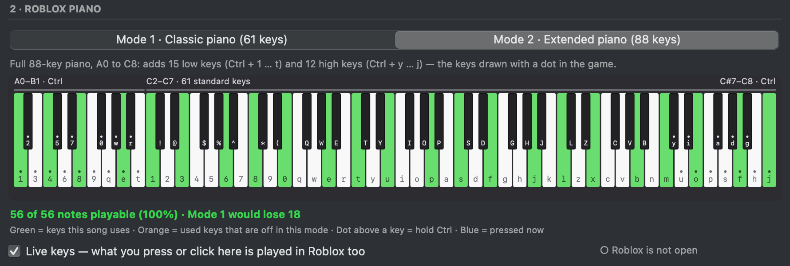
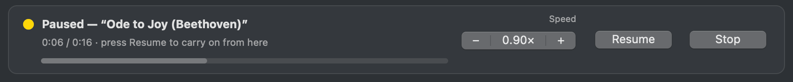

# Roblox MIDI Piano Player user manual

Everything in the window, in the order you meet it. Shortcuts are written for a Mac keyboard: ⌘ Command, ⌥ Option, ⇧ Shift, ⌃ Control.

## Contents

1. [The window](#1-the-window)
2. [Choosing a song](#2-choosing-a-song)
3. [The Roblox piano: Mode 1 and Mode 2](#3-the-roblox-piano-mode-1-and-mode-2)
4. [Reading the piano picture](#4-reading-the-piano-picture)
5. [Settings](#5-settings)
6. [Playing a song](#6-playing-a-song)
7. [While it plays: speed, pause, stop](#7-while-it-plays-speed-pause-stop)
8. [Live keys](#8-live-keys)
9. [Menus and keyboard shortcuts](#9-menus-and-keyboard-shortcuts)
10. [Language, notifications and the log](#10-language-notifications-and-the-log)
11. [The key maps](#11-the-key-maps)
12. [Uninstalling](#12-uninstalling)

## 1. The window

From top to bottom:

- **Title row.** The app's name and version, then **Open log**, **Config folder**, **About** and the language menu (**English** or **Français**).
- **Status card.** What is happening now (a coloured dot and a sentence), the song's position and length, and a progress bar. On the right: the **Speed** buttons, **Pause** and **Stop**.
- **1 · Song.** **Choose MIDI file…**, the song's name and details, and **Transpose this song**.
- **2 · Roblox piano.** **Mode 1** or **Mode 2**, a picture of the whole piano showing the keys the song uses, how many notes fit, and the **Live keys** switch.
- **3 · Settings.** The keyboard layout, the note mapping, how keys are sent, and the rest. They are saved as you change them.
- **Arm playback**, at the bottom.

The window opens where you left it.

## 2. Choosing a song

- **Choose MIDI file…**, or **File › Open MIDI…** (⌘O), opens a `.mid` or `.midi` file.
- **Drop** a MIDI file anywhere on the window.
- **File › Demo Songs** has three songs to try: *Ode to Joy* and *Für Elise* (both fit the classic piano) and *Full-range arpeggios*, which needs the 88-key piano.

The song's line then says how many notes it has, its lowest and highest note, how long it lasts at the current speed, and how long after your click it starts: *105 notes · G2 → D6 · about 1:12 at 1.00× · starts 0.5 s after your click*.

**Transpose this song** moves this one song up or down by up to 12 semitones (an octave), without touching your settings. It goes back to *0 · none* when you load another song. Use it when a song sits a little too high or too low for the piano; if every song does, change **Note of key 1** instead ([section 5](#5-settings)).

Every track of the file is played, and tempo changes in the file are followed. Each note is held for its real length. Drum tracks (MIDI channel 10) are left out, because drum sounds are not notes: the song's line says how many drum hits were left out. A file whose only notes are on channel 10 is played as it is.

## 3. The Roblox piano: Mode 1 and Mode 2

Roblox pianos come in two sizes. Choose the one that matches the piano in your game:

- **Mode 1 · Classic piano (61 keys)**, C2 to C7. White keys are `1` … `m` across your keyboard, black keys the same keys with Shift. Most piano games use it.
- **Mode 2 · Extended piano (88 keys)**, A0 to C8, the full range of a real piano, found in games such as *Talent Show*. On top of the 61 keys, holding **Ctrl** turns `1` … `t` into the 15 lowest notes and `y` … `j` into the 12 highest. The game draws those keys with a dot.

The line under the picture says what the other mode would change: *Mode 2 would play 18 more*, *Mode 1 would lose 18*, or *Mode 1 would play the same notes*.

Some 88-key pianos use **Option** instead of Ctrl for the dotted keys: see **Extended keys held with** in [section 5](#5-settings).

## 4. Reading the piano picture

The picture always shows all 88 keys, with the computer key that plays each one written on it. The three zones are named along the top: the low dotted keys, the 61 standard keys and the high dotted keys. In Mode 1 the dotted zones are dimmed and marked *off*.

| What you see | What it means |
| --- | --- |
| **Green key** | the song uses this note |
| **Orange key** | the song uses this note, but the current mode does not have it: those notes are skipped (Mode 2 would play them) |
| **Dot above a label** | hold Ctrl (or Option) for this key, as the game shows it |
| **Blue key** | pressed right now, from the keyboard or the mouse (see [Live keys](#8-live-keys)) |
| **◀ 10 notes below**, **8 notes above ▶** | notes the current mode cannot play, below or above its keys (in Mode 1, the orange keys show which of them Mode 2 has) |

Under the picture, the coverage line counts the notes that fit: *98 of 105 notes playable (93.3%) · skipped: 4 below the piano, 3 above it*. It is green when every note fits, and orange when more than a tenth are skipped.

With a **Legacy custom** layout, the picture is replaced by a short message: it exists only for the built-in layouts.

## 5. Settings

| Setting | Choices | What it does |
| --- | --- | --- |
| **Keyboard layout** | US QWERTY, French AZERTY, Legacy custom… | The letters written on the piano picture. Both built-in layouts press the same physical keys, so pick the one printed on your keyboard. **Legacy custom…** asks for a free-form layout, one character per semitone from the lowest note, for unusual pianos; it is always a classic piano. |
| **Note mapping** | Perfect — exact notes only; Smart best fit — may transpose | *Perfect* plays every note exactly where it is written and skips notes outside the piano. *Smart best fit* may shift the whole song by octaves (or, if it must, by semitones) so that more of it fits. |
| **Key sending** | Automatic (Quartz, then Accessibility); Quartz — fast; Accessibility — compatible | *Quartz* sends a key in about 2 ms, so a ten-note chord lands in about 20 ms. *Accessibility* takes 12–17 ms per key; it is there in case a Roblox update ever stops Quartz. *Automatic* uses Quartz and switches by itself if a send fails. |
| **Extended keys held with** | Control (standard), Option / Alt | The key held for the dotted keys of the 88-key piano. |
| **Speed** | 0.25× to 2× | The speed songs start at. The same speed as the buttons in the status card. |
| **Delay after click** | 0 to 30 seconds | How long after you click the Roblox window the song starts. |
| **Note of key 1** | a note name (`C2`) or a MIDI number (`36`) | The note the piano's key `1` plays: C2 on standard Roblox pianos. Change it only if every song sounds too high or too low; **Reset to C2** puts it back. In Mode 2 it cannot be lower than D#0, so that the 15 low keys exist. |
| **Also open the live log (Terminal)** | on, off | Opens a Terminal window that follows the log while a song plays. |

Hover over **Note mapping** or **Key sending** for a reminder of what each choice does.

## 6. Playing a song

1. Click **Arm playback**. The status reads *Starting the background player…*, then *Armed — click the Roblox piano window once*.
2. Click the Roblox window once (or switch to it any other way). The app waits until Roblox is the app in front, then for the **Delay after click**, then plays.
3. The status reads *Playing "…"*, with the position, the length, the speed and the number of notes sent.

The song is played by a separate background player, so it keeps going when you switch to other apps, when you close the window, and even when you quit the app. Reopen the app to see it, change its speed or stop it.

When it ends, the status reads *Finished "…"* for a quarter of an hour, then *Ready.* again. Arm the same song again to replay it.

**Return** presses **Arm playback** when it is available, as the window's default button.

## 7. While it plays: speed, pause, stop

- **−** and **+** slow the song down or speed it up by 0.05×, between 0.25× and 2×. The middle button shows the speed; click it to go back to 1×. The speed slider in the settings does the same.
- The change is heard within a tenth of a second, from the note that is playing: nothing jumps, and nothing rushes to catch up. Notes still keep their written lengths at the new speed.
- **Pause** lets go of every key and holds the song where it is; the dot turns yellow. **Resume** carries on from the same note. Pausing during the last notes ends the song.
- **Stop** ends the song and lets go of every key, including Shift and Ctrl.
- The speed you leave is saved: the next song starts at it.

You can change the speed before arming too, and while the song waits for your click.

## 8. Live keys

While the app's window is in front, it is also a keyboard for the Roblox piano:

- **Press piano keys on your keyboard** (`1` … `m`, Shift for the black keys, Ctrl with `1` … `t` and `y` … `j` for the dotted keys of the 88-key piano). Roblox gets the same keys at the same moment, and they turn blue on the picture. Holding a key holds the note.
- **Click a key on the picture.** Drag across the keys for a glissando; let go of the mouse to let go of the note.
- **Space** is passed on too: many Roblox pianos use it for the sustain pedal.

The line at the right of the **Live keys** switch says **Connected to Roblox** when Roblox is running, *Roblox is not open* otherwise, and *Allow Accessibility first* when macOS has not given the permission. The keys go straight to the Roblox process, so Roblox does not need to be in front.

To keep the rest of your keyboard safe:

- Only the piano's own keys and Space are passed on. **Escape, Return, Tab, the arrows, `/`** (which opens Roblox's chat) and every **⌘ shortcut** keep their usual meaning.
- Nothing is passed on while you type in a text field (**Delay after click**, **Note of key 1**). Press Return, or click the picture, to give the keys back to the piano.
- Every key sent down is let go when you switch to another window or app, press ⌘, open a menu, turn live keys off or quit the app. No key can stay stuck down in Roblox.

Live keys work while a song plays, so you can play along. Turn them off with the **Live keys** checkbox or **Playback › Live Keys** (⌘L). They use the **Key sending** setting.

## 9. Menus and keyboard shortcuts

| Menu | Command | Shortcut |
| --- | --- | --- |
| Roblox MIDI Piano Player | About Roblox MIDI Piano Player | |
| | Uninstall Roblox MIDI Piano Player… ([section 12](#12-uninstalling)) | |
| | Quit Roblox MIDI Piano Player | ⌘Q |
| File | Open MIDI… | ⌘O |
| | Demo Songs › Ode to Joy, Für Elise, Full-range arpeggios | |
| | Close Window | ⌘W |
| Edit | Undo, Redo, Cut, Copy, Paste, Select All (in the text fields) | ⌘Z, ⇧⌘Z, ⌘X, ⌘C, ⌘V, ⌘A |
| Playback | Pause / Resume | ⌘P |
| | Stop | ⌘. |
| | Faster / Slower (by 0.05×) | ⌘= / ⌘− |
| | Normal Speed | ⌘0 |
| | Live Keys (on or off) | ⌘L |
| Window | Minimize | ⌘M |
| Help | Roblox MIDI Piano Player Help (this manual, online) | ⌘? |
| | Getting Started, Troubleshooting, Report a Problem… | |

Closing the window quits the app; a song that is playing carries on.

## 10. Language, notifications and the log

- **Language.** The menu at the top right switches the whole window, its menus and its notifications between English and French. The first time, the app follows the language of macOS.
- **Notifications.** The background player tells you when a song is armed, when it is still waiting for your click (every 30 seconds), when it starts after a delay of a second and a half or more, and when it finishes, stops or meets an error.
- **Open log** opens `playback.log`, which records each step of the last song: the key sender used, when Roblox was detected, every speed change and pause, and how close to schedule the notes were. **Config folder** opens the folder that holds it, with your settings ([Getting started](getting-started.md#6-where-things-go) lists every file).
- **About** shows the version and opens this project's page.

## 11. The key maps

**Mode 1 · Classic piano (61 keys, C2–C7)**

| | Keys (US QWERTY) | Keys (French AZERTY) |
| --- | --- | --- |
| White keys, C2 → C7 | `1 2 3 4 5 6 7 8 9 0 q w e r t y u i o p a s d f g h j k l z x c v b n m` | `& é " ' ( - è _ ç à a z e r t y u i o p q s d f g h j k l w x c v b n ,` |
| Black keys | Shift + the white key on their left: `! @ $ % ^ * ( Q W E T Y I O P S D G H J L Z C V B` | the same physical keys with Shift |

**Mode 2 · Extended piano (88 keys, A0–C8)** adds, with **Ctrl** held (or Option):

| | Keys (US QWERTY) | Keys (French AZERTY) |
| --- | --- | --- |
| 15 lowest notes, A0 → B1 (white and black) | Ctrl + `1 2 3 4 5 6 7 8 9 0 q w e r t` | Ctrl + `& é " ' ( - è _ ç à a z e r t` |
| 12 highest notes, C#7 → C8 (white and black) | Ctrl + `y u i o p a s d f g h j` | Ctrl + `y u i o p q s d f g h j` |

The dotted keys are chromatic: each one is the next semitone, black keys included, so no Shift is involved. The piano picture shows every label.

## 12. Uninstalling

**Roblox MIDI Piano Player › Uninstall Roblox MIDI Piano Player…** removes the app and everything any version of it ever put on this Mac: this copy and every other one (whatever its version, wherever Spotlight or macOS knows of it, and in Applications, Downloads, Desktop and Documents), downloaded archives of it, the first version's source folder, the settings folder with its logs and old song files, the files macOS keeps for an app, and the Accessibility permission.

It lists everything with its size before doing anything. **Cancel** is the default; **Uninstall** moves it all to the Trash, or deletes it at once with **Delete right away, without the Trash** ticked. A song that is playing stops, other open copies close, and the app quits when it is done. [Getting started](getting-started.md#8-uninstalling) shows the same from Terminal.
